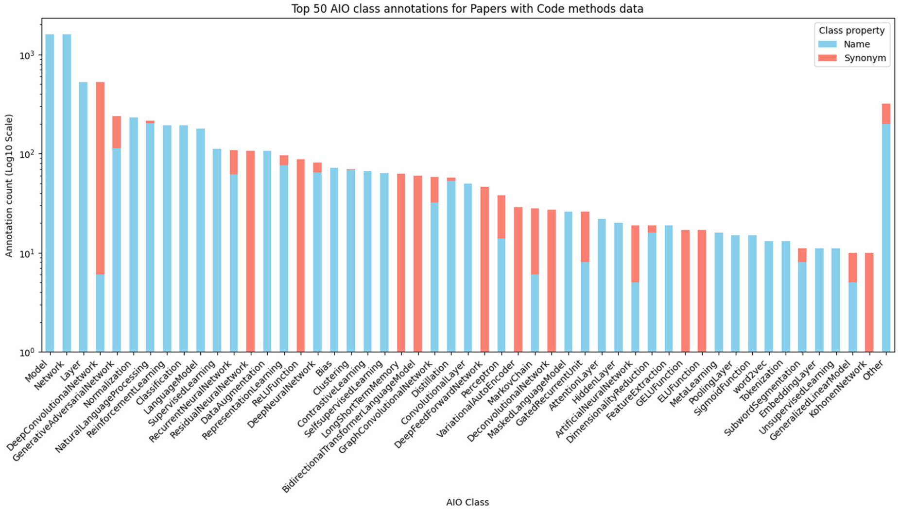
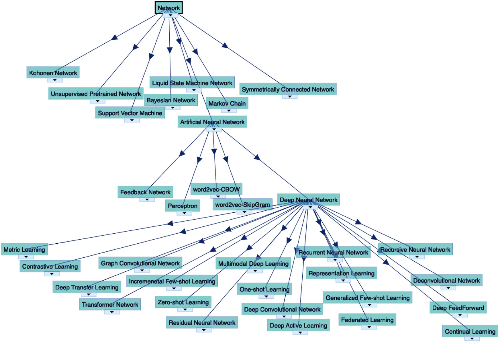

# The Artificial Intelligence Ontology: LLM-Assisted Construction of AI Concept Hierarchies

> Markdown conversion checked against the complete, locally supplied 11-page journal PDF. Running headers were removed, wrapped text and URLs rejoined, discretionary hyphens and ligatures normalized, and tables formatted as Markdown. Both original figures are embedded below. An extracted accent in the Simančík reference was restored from the PDF. The source PDF remains unchanged; article claims and figure captions are preserved.

**Authors:** Marcin P Joachimiak1 , Mark A Miller1, J Harry Caufield1, Ryan Ly2, Nomi L Harris1, Andrew Tritt3, Christopher J Mungall1 and Kristofer E Bouchard2,4,5,6

**Publication:** Applied Ontology 19(4), 408-418 (2024). Brief Ontology Report. © The Author(s) 2025. First published online March 2, 2025.

**DOI:** [10.1177/15705838241304103](https://doi.org/10.1177/15705838241304103)

**Source PDF:** [Local journal article](aio-applied-ontology.pdf), supplied by the user. [Repository record](https://escholarship.org/uc/item/9315g04c).

**Rights:** The [publisher](https://journals.sagepub.com/doi/abs/10.1177/15705838241304103) states [CC BY-NC 4.0](https://creativecommons.org/licenses/by-nc/4.0/). The eScholarship cover metadata instead states CC BY 4.0; these differing notices are retained in the source manifest. This Markdown is a format conversion with the changes listed above.

## Abstract

The Artificial Intelligence Ontology (AIO) is a systematization of artificial intelligence (AI) concepts, methodologies, and their interrelations. Developed via manual curation, with the additional assistance of large language models (LLMs), AIO aims to address the rapidly evolving landscape of AI by providing a comprehensive framework that encompasses both technical and ethical aspects of AI technologies. The primary audience for AIO includes AI researchers, developers, and educators seeking standardized terminology and concepts within the AI domain. We use the term “branches” for classes, and their subclasses, in our ontology that are subclasses of owl:Thing. AIO contains eight branches: Bias, Layer, Machine Learning Task, Mathematical Function, Model, Network, Preprocessing, and Training Strategy, each designed to support the modular composition of AI methods and facilitate a deeper understanding of deep learning architectures and ethical considerations in AI. AIO uses the Ontology Development Kit (ODK) for its creation and maintenance, with its content being more easily updated through AI-driven curation support. This approach not only ensures the ontology’s relevance amidst the fast-paced advancements in AI but also significantly enhances its utility for researchers, developers, and educators by simplifying the integration of new AI concepts and methodologies. The ontology’s utility is demonstrated through the annotation of AI methods data in a catalog of AI research publications and the integration into the BioPortal ontology resource, highlighting its potential for cross-disciplinary research. The AIO ontology is open source and is available on GitHub (https://w3id.org/aio/) and BioPortal (https://bioportal.bioontology.org/ontologies/AIO).

## Keywords

artificial intelligence, machine learning, AI, ML, AI/ML, artificial neural networks, deep neural networks, large language model, LLM, data preprocessing, model training strategy, bias

Received: 31 March 2024; accepted: 16 November 2024

## Author affiliations

1. Biosystems Data Science Department, Environmental Genomics and Systems Biology Division, Lawrence Berkeley National Laboratory, Berkeley, CA, USA

2. Scientific Data Division, Lawrence Berkeley National Laboratory, Berkeley, CA, USA

3. Applied Mathematics and Computational Research Division, Lawrence Berkeley National Laboratory, Berkeley, CA, USA

4. Biological Systems and Engineering Division, Lawrence Berkeley National Laboratory, Berkeley, CA, USA

5. Helen Wills Neuroscience Institute, Berkeley, CA, USA

6. Redwood Center for Theoretical Neuroscience, UC Berkeley, Berkeley, CA, USA

**Corresponding Author:** Marcin P. Joachimiak, Biosystems Data Science Department, Environmental Genomics and Systems Biology Division, Lawrence Berkeley National Laboratory, 1 Cyclotron Road, Berkeley, CA 94720, USA. Email: marcinjoachimiak@gmail.com

## 1 Introduction

The field of artificial intelligence (AI) is having a transformational effect on many research domains and human life in general. AI as a discipline encompasses both computational approaches and social and ethical aspects. Modeling knowledge about AI is essential to standardizing terminology, concepts, and their relationships. Previous work has focused on higher-level modeling of AI or machine learning (ML) concepts or more detailed modeling of statistical concepts and methods but has not kept up to date with the many advances in AI in recent years. The ACM Computing Classification (The 2012 ACM Computing Classification System) provides an extensive higher-level taxonomy of computing concepts including for AI; however, it does not cover concepts representing modular elements of AI methods, concepts related to bias, or the impressive number of types of AI methods developed since 2012, including large language models (LLMs). The Machine Learning Ontology (MLOnto; Braga et al., 2020) defines eight top-level classes covering both the processes and tools of ML as well as vocabulary and categorizations particular to the field (e.g., the MLOnto class MLTypes defines categories such as Unsupervised Learning), but has not been updated since 2020. Blagec et al. pursued similar goals, in their case yielding an Intelligence Task Ontology (ITO) and Knowledge Graph (Blagec et al., 2022). ITO places additional emphasis on measurements and benchmark results, along with relationships between specific performance metrics such as area under the curve (AUC) and BiLingual Evaluation Understudy (BLEU) score but, for example, does not include technical aspects of AI such as networks, mathematical functions, or layers, and has not been updated since 2022. Other resources such as the NIST (National Institute of Standards and Technology) AI glossary focus more on the terminology in the broader AI ecosystem (Schwartz & Fontana, 2023), rather than hierarchies of related methods, and do not include relationships. Cross-domain ontologies such as Ontology of Bioscientific Data Analysis and Data Management (EDAM; Black et al., 2022), Computer Science Ontology (CSO), and Software Ontology (SWO; Malone et al., 2014) also define many of the concepts relevant to AI, though with a focus on their respective domains rather than on AI applications or impact.

In some ways, the field of AI is self-categorizing. Repositories of AI literature and models already describe many concepts in community-defined ways. When the creators of ITO defined sets of benchmarks and tasks, for example, they began by extracting classifications from the Papers with Code (PWC) resource (Papers with Code—The Latest in Machine Learning). Since that time, and particularly with the successful application of LLMs, researchers have contributed massive quantities of new vocabulary to the field and a growing collection of new resources to open repositories (e.g., models and data in PWC, Hugging Face, code in GitHub) and this is not reflected and updated in potentially relevant ontologies. Even the term “artificial intelligence” itself has grown to encompass a widening assortment of methods, use cases, and general philosophies (Bearman et al., 2022). The exact relationship between models or methods and their results or publications often remains unspecified.

As part of the Artificial Intelligence Ontology (AIO) evaluation process we leveraged two types of alignment: annotating a current AI/ML resource (i.e., PWC) with AIO terms, demonstrating representation of current AI/ML concepts as they are used in practice. Additionally we provide formal ontological mappings to related ontologies. We note that many of the related ontologies were developed earlier and have not been updated recently, so they do not include many terms from the AI/ML field. The AIO construction process with LLM assistance is designed to make future ontology updates and maintenance easier and more reliable. Furthermore, as opposed to AI/ML use cases, the AIO focuses on technical details (including classes and definitions based on information in coding frameworks) for AI/ML methods and concepts and their implementations, such as layers and mathematical functions used, as well as concepts such as data preprocessing or bias considerations. The AIO explicitly does not attempt to curate AI/ML use cases or instances of specific models or methods, due to our modeling choices made with sustainability in mind.

We developed the AIO primarily to standardize concepts and relationships integral to AI methods, including the modular elements of AI methods represented in AI code frameworks as well as concepts related to bias. We have defined classes to cover more recent LLM advances and earlier approaches. With an eye toward technical applications, we have aligned the ontology with terminology used in ML platforms such as Tensorflow and PyTorch. We have designed the AIO to be rapidly extendable and responsive to new innovations in the field. Crucially, we have also included classes related to the ethical and legal impact of AI methods (Bender et al., 2021; Ning et al., 2023; e.g., we provide a top-level Bias class with 61 subclasses). Finally, the AIO was designed for and built with LLM-assisted content suggestion and curation support, which allows the ontology to more easily keep up to date and scale with advances in the AI fields. Collectively, these design decisions enable the AIO to satisfy community needs regarding standardization of AI/ML concepts across numerous areas of application, including serving as a knowledge source for generative AI platforms (Neuhaus, 2023). The AIO is an open source project (https://w3id.org/aio/) that encourages the broader community not only to make use of the ontology and related tools, but also to contribute comments, requests, and additions.

## 2 Methods

### 2.1 Ontology Creation Using the Ontology Development Kit (ODK)

We built the AIO using the ODK (Matentzoglu et al., 2022), which provides a standard way of organizing ontology content, as well as standard workflows integrated with GitHub actions for structurally and semantically validating the content of an ontology. We configured the ODK to use the ELK reasoner (Kazakov et al., 2014), which provides fast reasoning over the EL (existential lightweight) ontology profile (Motik et al., 2009) for validation of the AIO. The EL profile is designed for applications that require efficient reasoning capabilities, offering a balance between expressivity and computational efficiency. Note that, like many bio-ontologies, the AIO avoids complex OWL description logic (OWL-DL) constructs outside the EL profile.

We used the ODK to organize the AIO and to set up a GitHub repository (https://w3id.org/aio/) containing source components and workflows to build the ontology. The ODK includes a suite of ontology tools, including the very configurable open source ROBOT library (Jackson et al., 2019). As a result, each AIO build includes artifacts in a variety of serializations (Open Biological and Biomedical Ontology (OBO), OWL, and OBO-JSON) and variations to support multiple use cases (e.g., a base version without imported axioms). The AIO is built from an ontology ROBOT template https://w3id.org/aio/aio-src.csv). The ODK enables straightforward reproducibility as it is distributed as a Docker container; any user may build or modify the AIO with the same set of open source tools used in “official” builds.

We make each release of this ontology available through BioPortal (Whetzel et al., 2011). The BioPortal platform provides straightforward navigation of the AIO hierarchy and accessibility through a central Application Programming Interface (API) as well as a web user interface (UI). Additionally, the BioPortal API enables automatic generation of predicted lexical mappings between AIO classes and those in other ontologies. The ontology is also available as a SQLite database via the semantic-sql repository, allowing for expressive SQL queries, or programmatic access via the OAK (Ontology Access Kit) library.

### 2.2 Curation and Ingestion of Individual Branches

Data sources for individual ontology branches are as follows. The Network branch was developed from various sources including publications (Sarker, 2021), the Asimov Institute Neural Network Zoo (van Veen & Leijnen, 2016), PWC (Papers with Code—The Latest in Machine Learning), and Wikipedia (Wikipedia Contributors). Names of layers and mathematical functions used in AI method development were sourced from pyTorch (Paszke et al., 2019) and TensorFlow (Abadi, 2016) documentation. We included all Layers and Mathematical Functions from TensorFlow, but for demonstration purposes, we included only Normalization and Pooling Layers from PyTorch. Language Model, Preprocessing, and Training Strategy subclasses were developed using LLM approaches (see AI-assisted ontology development). AI Biases were sourced from a NIST report on AI bias (Schwartz et al., 2022) as well as from Wikipedia and publications. General ML methods were sourced from Wikipedia and a textbook (Brownlee, 2013). References for each ontology class are provided in the AIO data serializations produced by the ODK build.

To assist in automation, ROBOT templates were created for each of the main ontology branches. This allows each branch of the ontology to be compiled from Google Sheets with content generated using LLM prompts that can be easily authored and contributed to by domain experts. The template was manually created and the templates were populated using a mixture of automated and manual methods. The AIO defines 10 subsets, which are subproperties of oio:SubsetProperty. The AIO binds classes to those subsets with the oio:inSubset relation and references to sources are asserted with the oio:hasDbXref relation. The AIO subsets are a superset of the AIO branches and we use subsets to provide a grouping that is not available when one follows the single asserted parent rule.

The AIO content structured with ROBOT templates was also amenable to ontology construction using LLMs. We developed the LLM, Preprocessing, and Training Strategy branches of the ontology using Claude 3 Sonnet (accessed March 2024; Anthropic PBC, 2024) and GPT-4 (OpenAI, Achiam et al. 2023; accessed March 2024, additionally using the ROBOT-helper chatbot (Mungall, 2024). Prompts included example ontology data rows from the AIO ROBOT template, as a form of few-shot prompting, and requested extension of these data by the LLM with additional terms for the AIO LLM, Preprocessing, or Training Strategy ontology branches.

### 2.3 AI-assisted Ontology Development

AI can support humans in ontology development in multiple ways, including ontology seeding, extension, maintenance, and updating, as seen with recently emerging LLM-assisted tools for ontology applications and development (Caufield et al., 2023; Toro et al., 2023). The ROBOT ontology creation template enabled us to leverage LLMs to streamline the process of AIO ontology expansion and refinement. This straightforward tabular ontology format is amenable to interactions with LLMs by providing few-shot learning examples or even allowing to input of the entire AIO into prompt text. This approach allows us to more easily incorporate new AI concepts and methodologies into the AIO as they emerge. In summary, our AI-assisted ontology development strategy allows editors to work with the tabular ontology format (ROBOT template) faster, and to extract data from other sources (e.g., images, free text), all under human supervision.

Starting from the original definitions which were mostly copied directly from the sources, we performed a two-step LLM-assisted definition improvement. First, we used published ontology guidelines (Seppälä et al., 2017) and a custom prompt to ask GPT for revised original definitions that conform to the published ontology definition guidelines. Next, after human review, we used the GPT-revised definitions as input for a second prompt with Claude to generate Aristotelian definitions. Prompts are available in the AIO repository (https://github.com/berkeleybop/artificial-intelligence-ontology/tree/main/docs/prompts). Claude tends to generate more succinct answers which lead to shorter but still meaningful definitions. The final definitions were human-reviewed again and some required final manual edits.

### 2.4 Evaluation

In preparation for ontology mappings, we identified suitable ontologies through literature review. To generate inter-ontology mappings for this select set of ontologies, we used the OAK “lexmatch” command. In total, we identified only 259 mappings from the AIO to the following ontologies: the CSO with 53 mapped terms, the EDAM with 15, the ITO with 120, the MLO with 43, the National Cancer Institute Thesaurus (NCIT) with 23, and the SWO with four mappings. We also considered the Bioinformatics Web Services Ontology (OBwis; Guttula et al., 2011) but did not identify any mappings. Mappings are available at https://w3id.org/aio/mappings.

We focused on a real-world use case evaluation by annotating the methods data from the PWC resource, which collects papers about AI/ML methods. This was performed using the OAK framework (Ontology-Access-Kit, 2024), using the AIO ontology along with data on 2,194 publications describing AI/ML methods from the Papers with CodeMethods Corpus (https://production-media.paperswithcode.com/about/methods.json.gz, accessed on March 28, 2024). We used the OAK annotate command to identify exact matches of AIO class names as well as their synonyms across the different field values available in the PWC methods data. These results were summarized per AIO ontology class, with the final data shown in Figure 1.

Additional validation of the AIO was provided by integration into resources and use in specific application contexts. The integration of the AIO into BioPortal (https://bioportal.bioontology.org/ontologies/AIO) is dependent on the OWL serialization and while BioPortal does not require deep ontology validation, the UI aspects of the resource allow an ontology developer to quickly identify different types of ontology issues. The data-driven evaluation of the AIO by annotating PWC relied on the OAK framework, where we used Open Biomedical Ontology (OBO) format (The OBO Flat File Format Guide, Version 1.4) files directly or another ontology serialization available in OAK as a SQLite database. We also used SPARQL queries to generate a report for the AIO ontology; these data are used for Table 1. Finally, we used the Minimal Information for Reporting an Ontology (MIRO) guidelines (Matentzoglu et al., 2018) to help improve both the AIO ontology and this manuscript by inputting both the guidelines and the manuscript text into a GPT-4 prompt and asking which guidelines were met and which ones were not. This process was very efficient and effective, allowing to quickly analyze and improve the text and satisfy all MIRO guidelines. Thus, the AIO ontology was parsed, loaded, and utilized in five different contexts: ODK (construction, validation), LLMs (generation and validation), SPARQL (summarization), OAK (annotation), and BioPortal (UI and distribution). Each of these serves as a functional test of the ontology and a limited evaluation of practical applications.

### 2.5 Availability and License

The AIO is shared as an open resource under the Creative Commons Attribution 4.0 International License (CC BY 4.0), allowing for wide reuse and modification with proper attribution. We use BioPortal (Whetzel et al., 2011) as a means of distributing the ontology (https://bioportal.bioontology.org/ontologies/AIO), with BioPortal automatically pulling the ontology data serializations from GitHub releases (https://w3id.org/aio/). Development discussions and feature requests can be made through the AIO GitHub issue tracker (https://github.com/berkeleybop/artificial-intelligence-ontology/issues).

[Source PDF, page 5](aio-applied-ontology.pdf#page=5)

Figure 1. The number of AIO term mentions in PWC methods data, grouped by AIO ontology class. The top 20 classes with the most mentions are shown and the remainder are summarized in the final “Other” category.

**Table 1. Examples of AIO Classes, Definitions, Network Layer Axioms, and Layers.**

| Class | SuperClass | Definition |
| --- | --- | --- |
| AIO:Model | &lt;ROOT&gt; | An abstract representation of a complex system generally assembled as a set of logical mathematical or conceptual properties to simulate or understand the system’s behavior. |
| AIO:LanguageModel | AIO:Model | A model designed to predict the next word in a sequence or assign probabilities to sequences of words in natural language. |
| AIO:TransformerLanguageModel | AIO:LanguageModel | A language model that uses the transformer architecture based on multi-head attention mechanisms allowing it to contextualize tokens within a context window for effective language understanding and generation. |
| AIO:TransformerLLM | AIO:TransformerLanguageModel | A transformer language model with large training corpuses and sets of parameters that uses the transformer architecture based on multi-head attention mechanisms allowing it to contextualize tokens within a context window for effective language understanding and generation. |

| Class | SuperClass | Layer Axioms |
| --- | --- | --- |
| AIO:LongShortTermMemory | AIO:RecurrentNeuralNetwork | “has part” AIO:InputLayer &#124; “has part” AIO:MemoryCellLayer &#124; “has part” AIO:OutputLayer |

| Class | SuperClass | Definition |
| --- | --- | --- |
| AIO:InputLayer | AIO:Layer | A layer composed of artificial input neurons that brings the initial data into the system for further processing by subsequent layers. |
| AIO:MemoryCellLayer | AIO:Layer | A layer of cells, each with an internal state or weights. |
| AIO:OutputLayer | AIO:Layer | A layer containing the last neurons in the network that produces given outputs for the program. |

[Source PDF, page 6](aio-applied-ontology.pdf#page=6)

Figure 2. Structure of the network branch of the AIO. For simplicity, not all child nodes are shown. The interactive AIO visualization is available at https://bioportal.bioontology.org/ontologies/AIO.

**Table 2. AIO Branch Summary Statistics.**

| Branch summary statistic | Bias | Layer | Machine learning task | Mathematical function | Model | Network | Preprocessing | Training Strategy | Total |
| --- | ---: | ---: | ---: | ---: | ---: | ---: | ---: | ---: | ---: |
| Class count | 61 | 168 | 57 | 14 | 76 | 52 | 10 | 4 | 442 |
| “Subclass of” count | 61 | 168 | 63 | 14 | 76 | 117 | 10 | 4 | 513 |
| Synonym count | 26 | 71 | 55 | 10 | 157 | 82 | 25 | 13 | 439 |

## 3 Results

### 3.1 High-level Ontology Structure

The AIO structure consists of eight top-level branches: Bias, Layer, Machine Learning Task, Mathematical Function, Model, Network, Preprocessing, and Training Strategy. The Network (Figure 2), Layer, and Function branches are interlinked, with many Network classes having a representation based on a series of Layer terms. Thus, the Layer and Function branches are modeled to support modular composition to enable flexible representations of possible methods based on existing AI development frameworks. We summarize major ontology features for the AIO in Table 2. The ontology contains 442 classes, 439 synonyms for these classes, and 513 subclass of relationships. The cases where the subclass axiom count is higher than the class count correspond to classes that are asserted to have layers. The AIO outlines the various types of layers (e.g., convolutional, recurrent, pooling) and functions (e.g., activation functions, loss functions) that constitute AI/ML models.

We highlight examples of AIO class definitions in Table 1, starting from the parent of an ontology branch (AIO:Model), through two intermediate parent classes (AIO:LanguageModel and then AIO:TransformerLanguageModel), and ending with a leaf ontology class (AIO:TransformerLLM). To demonstrate how AIO terms are interlinked, also shown are network layer axioms and definitions for the layers which are part of Long-Short Term Memory networks (AIO:LongShortTermMemory).

### 3.2 Representing Data Content and Ethical Aspects of AI: Bias

Bias in AI research and applications directly impacts the fairness, reliability, and generalizability of AI systems. The standardization of AI concepts, including the identification and mitigation of bias, is crucial for developing AI technologies that are both effective and equitable. The NIST report on AI bias provides a taxonomy of bias concepts relevant to AI as well as guidelines for identifying and managing bias in AI systems. The Bias branch in the AIO was developed using a NIST report on AI bias (Schwartz et al., 2022) and related Wikipedia entries. Small numbers of bias-related terms exist in a small number of ontologies, for example, the NCIT, which defines five types of bias including molecular sequencing biases, which are out of scope for core AI/ML applications. The AIO supports a more systematic and comprehensive approach to characterizing bias concepts relevant to AI, including a range of bias classes and their synonyms for more traditional biases from statistics and sociology. This branch encompasses biases that can arise throughout the AI development lifecycle, from data collection and model training to the deployment and evaluation of AI systems. It includes the following bias categories: computational, historical, human, institutional, societal, and systemic. Different biases in these categories can significantly affect the performance and fairness of AI models and their applications.

### 3.3 Natural Language Processing (NLP) Evaluation

We conducted a NLP evaluation to assess the coverage and applicability of the AIO within the context of practical AI research. The goal was to demonstrate that the AIO covers the range of standardized concepts represented in current AI research and development practices as documented in the PWC Methods Corpus, by finding lexical matches between AIO term labels and synonyms and terms in the PWC data (see Methods).

The process utilized standard concept recognition techniques to ensure accurate matching, taking into account variations in terminology and the use of synonyms within the AI field (Mungall et al., 2022). This approach allowed us to map the vast array of methods and technologies listed in PWC to the structured hierarchy of the AIO, thereby validating the ontology’s relevance and utility in categorizing AI methodologies. The PWC methods classification describes seven AI/ML methods areas, and two areas (“Natural Language Processing” and “Reinforcement Learning”) are represented in the AIO, with “Audio,” “Computer Vision,” “General,” “Graph,” and “Sequential” not represented in the AIO because they are out of scope for AI/ML-specific concepts. PWC also has 313 collections and AIO terms represent 36 of these. We note that AIO and PWC have different scopes: PWC is not developing an ontology but rather constructing a controlled vocabulary with categories, thus allowing it to include terms corresponding to every topic that appears in multiple papers. This approach is much more scalable and could even be performed in an automated manner. On the other hand, it leaves out many relevant terms. Nearly half of AIO terms, 214 out of the 443, were found in paper titles and method classification fields of the PWC Methods Corpus data. This represents a high level of coverage of AIO terms given that many Bias, Layer, and Mathematical Function AIO classes are unlikely to be explicitly represented in these data. These results suggest that while PWC is a good data source for extending the AIO, the AIO can also help inform AI/ML resources about other potential standardized terms and relationships for classification.

The results of this evaluation are summarized by the number of mentions of AIO classes within the PWC Methods Corpus data (Figure 1). There were a total of 7,582 AIO annotations for the PWC methods data. 6,137 of these annotations were exact matches to an AIO ontology class label, and 1,445 annotations were exact synonyms.

Within the mentions of AIO terms in the PWC methods data, we observed significant coverage of AIO classes related to deep learning architectures, data preprocessing techniques, and ethical considerations in AI, among others. A number of terms were found as their exact synonym representing an acronym, for example, RNN for Residual Neural Network or ReLU for Rectified Linear Unit. This NLP evaluation demonstrates the AIO’s alignment with current AI research trends but also highlights potential areas for ontology refinement and extension. We can use this evaluation as a reproducible process to continuously update the AIO in the future.

### 3.4 Example Application: Enhanced Model Cards

Enhancing the Model Cards concept (Mitchell et al., 2019) is an example of how the AIO can be leveraged to improve transparency and understanding of AI models. Model Cards, which document the performance characteristics and intended uses of AI models, can be enhanced by the standardized terminology and concepts provided by the AIO. By incorporating the AIO into Model Cards, developers can offer more detailed and comprehensible descriptions of their models’ architectures, functionalities, and ethical considerations. In turn, model users and the public can benefit from these standardized records. This not only facilitates better communication within the research community but also promotes responsible AI development and deployment by ensuring that AI model users have a clear understanding of a model’s capabilities and limitations.

## 4 Discussion

### 4.1 Use Cases

The use cases for the AIO are diverse, reflecting its broad applicability across AI research and development. From enhancing transparency in AI methodologies to facilitating the annotation and comparison of AI models, the AIO has the potential to serve as a foundational tool for adding transparency to AI technologies. It can enable researchers to identify sets of methods or publications referring to a standardized AI term, along with more complex applications such as comparing model code implementations and developing formal distance measures between AI/ML methods. By standardizing AI terminology, the AIO supports the annotation of code repositories and academic papers. We consider this terminological consistency to be one strategy toward clarifying communication between researchers, particularly as AI methods are adopted in new domains. Providing a standardized methodological vocabulary may also assist AI research newcomers in understanding publications in this often opaque field (Kocak et al., 2021), especially the links between method code and method descriptions and method classifications. We note that 41% of all AIO concepts refer to Layers and Mathematical Functions. Finally, the AIO ontology formats support interoperability with a growing number of LLM-based tools (Caufield et al., 2023; Mungall et al., 2022; Toro et al., 2023; Caufield et al. 2024).

### 4.2 Alignment with OBO

The AIO aligns with OBO Foundry (Jackson et al., 2021) standards and principles, in particular by providing class definitions including for upper-level classes. The AIO is not intended to be part of the OBO Foundry, as its scope extends beyond biology. However, we aim to follow OBO principles where possible, while at the same time allowing the AIO to be used in other non-OBO settings. Many OBO ontologies are classified using the Basic Formal Ontology (BFO), with some moving to the Common Ontology for Biology (COB), which makes use of parts of BFO and commonly used upper-level terms from existing ontologies in OBO. We have classified the upper levels of the AIO in a way that is consistent with BFO and COB. Rather than include the classification directly into the main release of the ontology, we provide bridging axioms in a separate module that can be easily composed with the main AIO release (https://w3id.org/aio/bridge/aio-bridge-to-upper.owl). The bridge file places the AIO bias term under BFO disposition; mathematical function, ML task, and preprocessing under Ontology for Biomedical Investigations’s (OBI) planned process; and layer, model, network, and training strategy underneath Information Artifact Ontology’s (IAO) information content entity.

### 4.3 Ongoing Maintenance

Ongoing maintenance of the AIO is crucial for its relevance and utility in the fast-paced field of AI. This maintenance involves regular updates to incorporate new AI methodologies, tools, and ethical considerations, ensuring that the ontology accurately reflects current practices and advancements. The process is supported by AI-driven tools that facilitate the identification and integration of emerging concepts. There are a series of strategies in place for keeping the AIO up to date. Some of these are technical, like how the build process is reproducible with the ODK. Some are social, like following OBO strategies and the MIRO guidelines, such that the AIO integrates well with other resources and should continue to do so. In addition, a number of in-progress or near-future strategies involve using the OAK (Mungall et al., 2022), for example automating lexical mappings and mining literature for new candidate ontology classes, term synonyms, as well as novel AI model architectures.

### 4.4 Limitations

The limitations of the AIO primarily concern its scope and the inherent complexity of AI technologies. The AIO aims to cover a broad range of AI concepts but does not delve into the specifics of individual model implementations or parameter values, which can vary widely across different applications. This limitation is intentional to manage complexity and maintain the ontology’s usability. There is also a simplification in the AIO regarding modeling Network Layers, as these are represented as a list but may have more sophisticated, nonlinear architectures, for example, with loops. Another limitation is that while the ontology is designed with composable concepts, this may not yet suffice for supporting full concept composability due to the previously mentioned lack of parameters but also because method composability requires alignment with respect to the input data and for now that aspect is out of scope for the AIO. Future developments may address these aspects to further enhance the AIO’s applicability.

### 4.5 AI Model and AI Research Publication Catalogs

The advent of catalogs for AI publications and models such as PWC, Hugging Face, as well as code repositories such as GitHub, marks a crucial step toward standardization in the rapidly evolving AI field. These resources represent different substrates for annotation with AIO ontology terms and are becoming key resources for promoting reproducibility, enhancing collaboration, and ensuring that innovations are easily accessible. The incorporation of the AIO into these platforms, or for analysis of data from these platforms, could further standardize AI terminology and concepts.

## 5 Conclusion

The AIO advances the standardization and understanding of AI concepts and methodologies. By providing a comprehensive framework for AI terminology, the AIO facilitates clearer communication, collaboration, and sharing of results within the AI community. Its applications, from enhancing model cards to supporting ongoing projects, demonstrate its value across different domains. The AIO’s sustainability is supported by regular updates, community contributions, and adherence to best practices in ontology management. As the field of AI continues to expand, the framework supporting the AIO development and maintenance should be better equipped to keep pace, thanks to its automated ontology validation, integration with multiple use cases, and LLM-assisted capabilities for ontology extension and maintenance. The AIO can help ensure that AI reports, comparisons, and advancements are grounded in a standardized and accessible vocabulary.

## ORCID iD

Marcin P. Joachimiak https://orcid.org/0000-0001-8175-045X

## Statements and Declarations

### Funding

The authors disclosed receipt of the following financial support for the research, authorship, and/or publication of this article: This work is supported by the Advanced Scientific Computing Research (ASCR) program in the U.S. Department of Energy, Office of Science, Office of Biological and Environmental Research (BER) [DE-AC02-05CH11231 to LBNL].

### Declaration of Conflicting Interests

The authors declared no potential conflicts of interest with respect to the research, authorship, and/or publication of this article.

## References

The 2012 ACM Computing Classification System. Retrieved June 11, 2024, from https://www.acm.org/publications/class-2012

Abadi, M. (2016). TensorFlow: Learning functions at scale. In J. Garrigue, G. Keller, & E. Sumii (Eds.), Proceedings of the 21st ACM SIGPLAN International Conference on Functional Programming, Nara, Japan, September 18–24 (p. 1). Association for Computing Machinery.

OpenAI, Achiam, J., Adler, S., Agarwal, S., Ahmad, L., Akkaya, I., Aleman, F. L., Almeida, D., Altenschmidt, J., Altman, S., Anadkat, S., Avila, R., Babuschkin, I., Balaji, S., Balcom, V., Baltescu, P., Bao, H., Bavarian, M., Belgum, J., & Zoph, B. (2023). GPT-4 Technical Report. arXiv [cs.CL]. http://arxiv.org/abs/2303.08774

Anthropic PBC. (2024). Introducing the next generation of Claude. Retrieved March 30, 2024, from https://www.anthropic.com/news/claude-3-family

Bearman, M., Ryan, J., & Ajjawi, R. (2022). Discourses of artificial intelligence in higher education: A critical literature review. Higher Education, 86(2), 369–385. https://doi.org/10.1007/s10734-022-00937-2

Bender, E. M., Gebru, T., McMillan-Major, A., & Shmitchell, S. (2021). On the dangers of stochastic parrots: Can language models be too big? In Proceedings of the 2021 ACM Conference on Fairness, Accountability, and Transparency, Virtual Event Canada, March 3–10 (pp. 610–623). Association for Computing Machinery.

Black, M., Lamothe, L., Eldakroury, H., Kierkegaard, M., Priya, A., Machinda, A., Khanduja, U. S., Patoliya, D., Rathi, R., Nico, T. P. C., Umutesi, G., Blankenburg, C., Op, A., Chieke, P., Babatunde, O., Laurie, S., Neumann, S., Schwämmle, V., Kuzmin, I., & Kalaš, M. (2022). EDAM: The bioscientific data analysis ontology (update 2021; Vol. 11). F1000 Research Limited. https://doi.org/10.7490/F1000RESEARCH.1118900.1

Blagec, K., Barbosa-Silva, A., Ott, S., & Samwald, M. (2022). A curated, ontology-based, large-scale knowledge graph of artificial intelligence tasks and benchmarks. Scientific Data, 9(1), Article 322. https://doi.org/10.1038/s41597-022-01435-x

Braga, J., Dias, J. L. R., & Regateiro, F. (2020). A machine learning ontology. Preprint, Frenxiv. https://doi.org/10.31226/osf.io/rc954

Brownlee, J. (2013). A tour of machine learning algorithms. Machine Learning Mastery. https://machinelearningmastery.com/a-tour-of-machine-learning-algorithms/

Caufield, J. H., Hegde, H., Emonet, V., Harris, N. L., Joachimiak, M. P., Matentzoglu, N., Kim, H., Moxon, S. A. T., Reese, J. T., Haendel, M. A., Robinson, P. N., & Mungall, C. J. (2023). Structured prompt interrogation and recursive extraction of semantics (SPIRES): A method for populating knowledge bases using zero-shot learning. arXiv [cs.AI]. http://arxiv.org/abs/2304.02711

Caufield, J. H., Kroll, C., O’Neil, S. T., Reese, J. T., Joachimiak, M. P., Hegde, H., Harris, N. L., Krishnamurthy, M., McLaughlin, J. A., Smedley, D., Haendel, M. A., Robinson, P. N., & Mungall, C. J. (2024). CurateGPT: A flexible language-model assisted biocuration tool. arXiv:2411.00046. https://doi.org/10.48550/arXiv.2411.00046

Guttula, C., Dhamanaskar, A., Wang, R., Miller, J. A., Kissinger, J. C., Zheng, J., & Jr Stoeckert, C. J. (2011). Enriching the Ontology for Biomedical Investigations (OBI) to improve its suitability for web service annotations. ICBO.

Jackson, R. C., Balhoff, J. P., Douglass, E., Harris, N. L., Mungall, C. J., & Overton, J. A. (2019). ROBOT: A tool for automating ontology workflows. BMC Bioinformatics, 20(1), Article 407. https://doi.org/10.1186/s12859-019-3002-3

Jackson, R., Matentzoglu, N., Overton, J. A., Vita, R., Balhoff, J. P., Buttigieg, P. L., Carbon, S., Courtot, M., Diehl, A. D., Dooley, D. M., Duncan, W. D., Harris, N. L., Haendel, M. A., Lewis, S. E., Natale, D. A., Osumi-Sutherland, D., Ruttenberg, A., Schriml, L. M., Smith, B., & Peters, B. (2021). OBO foundry in 2021: Operationalizing open data principles to evaluate ontologies. Database: The Journal of Biological Databases and Curation, 2021, Article baab069. https://doi.org/10.1093/database/baab069

Kazakov, Y., Krötzsch, M., & Simančík, F. (2014). The incredible ELK. Journal of Automated Reasoning, 53(1), 1–61. https://doi.org/10.1007/s10817-013-9296-3

Kocak, B., Kus, E. A., & Kilickesmez, O. (2021). How to read and review papers on machine learning and artificial intelligence in radiology: A survival guide to key methodological concepts. European Radiology, 31(4), 1819–1830. https://doi.org/10.1007/s00330-020-07324-4

Malone, J., Brown, A., Lister, A. L., Ison, J., Hull, D., Parkinson, H., & Stevens, R. (2014). The software ontology (SWO): A resource for reproducibility in biomedical data analysis, curation and digital preservation. Journal of Biomedical Semantics, 5(1), Article 25. https://doi.org/10.1186/2041-1480-5-25

Matentzoglu, N., Goutte-Gattat, D., Tan, S. Z. K., Balhoff, J. P., Carbon, S., Caron, A. R., Duncan, W. D., Flack, J. E., Haendel, M., Harris, N. L., Hogan, W. R., Hoyt, C. T., Jackson, R. C., Kim, H., Kir, H., Larralde, M., McMurry, J. A., Overton, J. A., Peters, B., & Osumi-Sutherland, D. (2022). Ontology development kit: A toolkit for building, maintaining and standardizing biomedical ontologies. Database: The Journal of Biological Databases and Curation, 2022, Article baac087. https://doi.org/10.1093/database/baac087

Matentzoglu, N., Malone, J., Mungall, C., & Stevens, R. (2018). MIRO: Guidelines for minimum information for the reporting of an ontology. Journal of Biomedical Semantics, 9(1), Article 6. https://doi.org/10.1186/s13326-017-0172-7

Mitchell, M., Wu, S., Zaldivar, A., Barnes, P., Vasserman, L., Hutchinson, B., Spitzer, E., Raji, I. D., & Gebru, T. (2019). Model cards for model reporting. In Proceedings of the Conference on Fairness, Accountability, and Transparency, Atlanta GA USA, January 29–31 (pp. 220–229). Association for Computing Machinery.

Motik, B., Grau, B. C., Horrocks, I., Wu, Z., Fokoue, A., & Lutz, C. (2009). OWL 2 web ontology language profiles. W3C Recommendation, 27(61). https://www.w3.org/2007/OWL/draft/ED-owl2-profiles-20090610/all.pdf

Mungall, C. (2024). AI guided ontology curation workflows and the ROBOT template GPT helper. https://doi.org/10.5281/zenodo.10901704

Mungall, C., Harshad, P., Kalita, , Hoyt, C. T., Patil, S., Joachimiak, M. p., Deepak, H., Caufield, , Flack, J., Reese, J., Matentzoglu, N., Harris, N., & Tan, S. (2022). INCATools/ontology-access-kit: v0.1.37. https://doi.org/10.5281/zenodo.7032471

Neuhaus, F. (2023). Ontologies in the era of large language models—A perspective. Applied Ontology, 18(4), 399–407. https://doi.org/10.3233/AO-230072

Ning, Y., Teixayavong, S., Shang, Y., Savulescu, J., Nagaraj, V., Miao, D., Mertens, M., Ting, D. S. W., Ong, J. C. L., Liu, M., Cao, J., Dunn, M., Vaughan, R., Ong, M. E. H., Sung, J. J.-Y., Topol, E. J., & Liu, N. (2023). Generative artificial intelligence in healthcare: Ethical considerations and assessment checklist. arXiv [cs.LG]. http://arxiv.org/abs/2311.02107

The OBO Flat File Format Guide, Version 1.4. Retrieved March 30, 2024, from https://owlcollab.github.io/oboformat/doc/GO.format.obo-1_4.html

Ontology-Access-Kit. (2024).Ontology Access Kit: A Python library and command line application for working with ontologies. GitHub. Retrieved March 29, 2024, from https://github.com/INCATools/ontology-access-kit

Papers with Code—The latest in Machine Learning. Retrieved March 30, 2024, from https://paperswithcode.com/

Paszke, A., Gross, S., Massa, F., Lerer, A., Bradbury, J., Chanan, G., Killeen, T., Lin, Z., Gimelshein, N., Antiga, L., Desmaison, A., Köpf, A., Yang, E., DeVito, Z., Raison, M., Tejani, A., Chilamkurthy, S., Steiner, B., Fang, L., & Chintala, S. (2019). PyTorch: An imperative style, high-performance deep learning library. Advances in Neural Information Processing Systems, 721, 8026–8037. https://proceedings.neurips.cc/paper/2019/hash/bdbca288fee7f92f2bfa9f7012727740-Abstract.html

Sarker, I. H. (2021). Deep learning: A comprehensive overview on techniques, taxonomy, applications and research directions. SN Computer Science, 2(6), Article 420. https://doi.org/10.1007/s42979-021-00815-1

Schwartz, R., & Fontana, P. C., & Information Technology Laboratory (National Institute of Standards and Technology). (2023). The language of trustworthy AI: An in-depth glossary of terms. U.S. Department of Commerce, National Institute of Standards and Technology.

Schwartz, R., Vassilev, A., Greene, K., Perine, L., Burt, A., & Hall, P. (2022). Towards a standard for identifying and managing bias in artificial intelligence. https://doi.org/10.6028/nist.sp.1270

Seppälä, S., Ruttenberg, A., & Smith, B. (2017). Guidelines for writing definitions in ontologies. Ciência da Informação, 46(1), 73–88.

Toro, S., Anagnostopoulos, A. V., Bello, S., Blumberg, K., Cameron, R., Carmody, L., Diehl, A. D., Dooley, D., Duncan, W., Fey, P., Gaudet, P., Harris, N. L., Joachimiak, M., Kiani, L., Lubiana, T., Munoz-Torres, M. C., O’Neil, S., Osumi-Sutherland, D., Puig, A., & Mungall, C. J. (2023). Dynamic retrieval augmented generation of ontologies using artificial intelligence (DRAGON-AI). arXiv [cs.AI]. http://arxiv.org/abs/2312.10904

van Veen, F., & Leijnen, S. (2016, September 14). The neural network zoo. The Asimov Institute. https://www.asimovinstitute.org/neural-network-zoo/

Whetzel, P. L., Noy, N. F., Shah, N. H., Alexander, P. R., Nyulas, C., Tudorache, T., & Musen, M. A. (2011). Bioportal: Enhanced functionality via new web services from the National Center for Biomedical Ontology to access and use ontologies in software applications. Nucleic Acids Research, 39(Web Server issue), W541–W545. https://doi.org/10.1093/nar/gkr469

Wikipedia Contributors. Wikipedia, the free encyclopedia. https://www.wikipedia.org/
